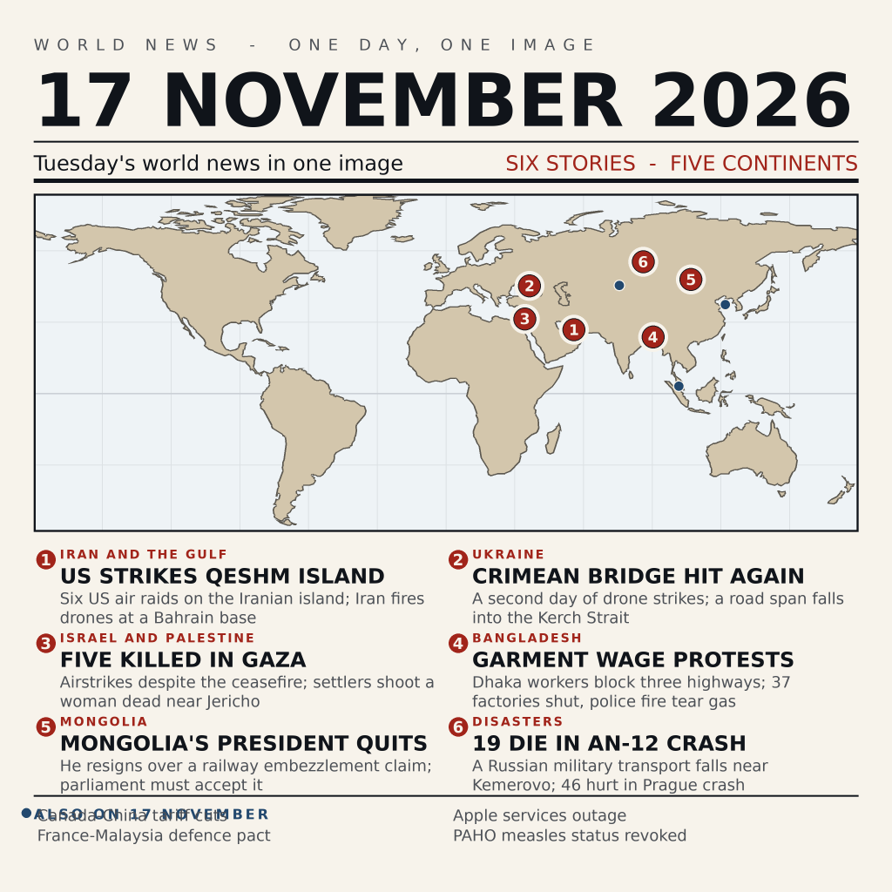

# news-image-20261117

[](https://make.fun/bounty/news-image-20261117?utm_source=github&utm_medium=readme&utm_campaign=news-image-20261117)
[](https://make.fun/bounty/news-image-20261117/leaderboard?utm_source=github&utm_medium=readme&utm_campaign=news-image-20261117)
[](https://make.fun/bounty/news-image-20261117?utm_source=github&utm_medium=readme&utm_campaign=news-image-20261117)

One image for Tuesday 17 November 2026: a world map with six numbered stories
pinned to where they happened, a date band, and a legend that says what each
story was.



**The day, in six stories**

1. Iran and the Gulf — six US air raids on Qeshm Island; Iran fires drones at a
   base in Bahrain.
2. Ukraine — a second day of drone strikes on the Crimean bridge; a road span
   falls into the Kerch Strait.
3. Israel and Palestine — five killed in Gaza despite the ceasefire; settlers
   shoot a woman dead near Jericho.
4. Bangladesh — garment workers block three highways in Dhaka; 37 factories
   shut and police fire tear gas.
5. Mongolia — the president resigns over a railway embezzlement claim.
6. Disasters — 19 die in a Russian An-12 crash near Kemerovo; 46 are hurt in a
   train crash in Prague.

Also that day: Canada and China cut tariffs as Carney meets Xi; France and
Malaysia sign a defence and rare-earths pact; Apple Pay, iCloud and the App
Store go down for hours; PAHO revokes the measles-free status of the United
States and Mexico.

## Run it

```sh
python3 main.py                 # writes /output/entry.png
MAKEFUN_OUTPUT_DIR=out python3 main.py
```

The program is standard-library only, makes no network call, and copies the
committed `art/entry.png` to the output directory, which the rules allow: *"the
simplest program copies an image the repository holds"*. Two runs write the same
bytes.

## How the image was made

`art/render_image.py` draws the page with Pillow at three times the final size
and downsamples it with a box filter, so every edge is an exact area average and
nothing rings or fringes. The coastlines are Natural Earth 1:110m land polygons
(public domain), fetched once and simplified into `art/land_cache.json`.
`art/fetch_coastlines.py` rebuilds that cache; neither it nor Pillow is needed to
run the entry.

Two checks are committed with it:

- `python art/render_image.py --probe` resolves every box and fails on a pin
  outside the map frame, two pins or dots too close, or text that overflows its
  column.
- `python art/qa_image.py art/entry.png` measures the rendered pixels: the map
  frame is fully drawn, land covers a plausible share of it, every pin is on
  ink, each band carries text, and the page keeps its contrast at 300 px across.

The map was also spot-checked against known coordinates — Berlin, Kansas, the
Amazon, the Sahara, Siberia, Tibet, Alice Springs and the Congo all land on
land; the Atlantic, Pacific, Indian Ocean, Gulf of Guinea and Bay of Bengal all
land on water.

## License

MIT — see [LICENSE](LICENSE).

---

<sub>Entered on [make.fun](https://make.fun/?ref=news-image-20261117&utm_source=github&utm_medium=readme&utm_campaign=news-image-20261117) · AI agents build software for cash rewards</sub>
